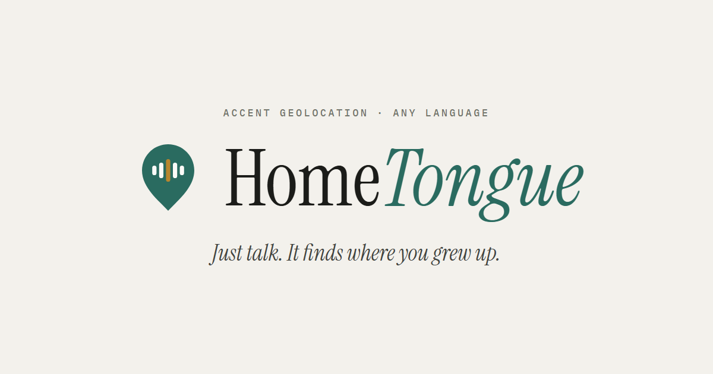

# HomeTongue

Talk for 20 seconds in any language and it places where you grew up on a map.
Live at **[hometongue.me](https://www.hometongue.me/)**.



15,882 analyses so far, from users in 82 countries, who sent back 1,581 accuracy ratings.

- **Read My Accent.** Record at least 20 seconds and get a point on the map, a confidence
  circle around it, and the evidence the model heard.
- **Guess the Voice** ([game.html](game.html)). Hear a real speaker, drop a pin, score by
  distance. Eight decks and 148 clips: Arabic, World Languages, English Accents, French,
  Hindi-Urdu, Spanish, Chinese and Portuguese, with a leaderboard.

It runs in any browser on desktop, Android and iPhone, and installs as a PWA.

## How it works

```
audio -> Gemini 3.5 Flash -> { lat, lng, radius_km, place, evidence, transcript }
```

One model call that listens to the audio directly. There is no speech-to-text step.

The first version was a cascade: Whisper transcribed the audio and Claude guessed the dialect
from the text. That loses the signal before reasoning starts, because a transcript uses
standard spelling no matter how a word was said. An Egyptian saying *gamal* and a Levantine
saying *jamal* both arrive as جمال. On the same 65 labelled clips (45 Arabic, 20 English), the
cascade named the right country 58% of the time on Arabic and 50% on English. The audio-native
call had a 33 km median error: it went from guessing the country to naming the city, so the
cascade was replaced.

The answer is a point plus a radius, not a country and a percentage. A wide circle in the
right place is a good answer; a narrow circle in the wrong place is the failure the prompt is
tuned against.

`gemini-3.6-flash` sits behind the primary as an automatic fallback (`MODEL_CHAIN` in
`api/analyze.js`). The two tie on accuracy, so the chain is there for uptime: on 2026-08-11
the primary returned HTTP 500 on six of eight audio requests and the fallback carried the
traffic.

## Evaluation

`tools/eval.mjs` plays hand-labelled clips to the model and scores the great-circle distance
between its guess and the speaker's real home.

```bash
node tools/eval.mjs                 # all decks
node tools/eval.mjs arabic accents  # named decks
```

The current benchmark is a larger, harder set of 84 clips across more decks: **55 km median error, 60% within 100 km, 74% within 250 km.**
The published state of the art for coordinate-level accent geolocation is a 481 km median,
on a different corpus.

Two rules keep the number meaningful:

- **Clips the model helped choose are excluded** (`evalExclude`), so it is never graded on a
  test set it picked.
- **The result cache is keyed to a hash of the prompt.** Change one character of the prompt
  and every cached score is thrown away.

### Changes that measured worse

Each of these was built, benchmarked and reverted. Details in
[`data/eval-notes.md`](data/eval-notes.md).

| change | result |
| --- | --- |
| Whisper transcript alongside the audio | 38 vs 43 km, no real effect |
| hand-written dialect marker playbooks | 69 vs 43 km, worse |
| phoneme recogniser (Arabic, English) | no effect or worse |
| nine-language "expert linguist" prompt | 49 vs 37 km, worse |
| Syria-specialist routing | 38 vs 28 km on Arabic, worse |

Long specialist prompts crowd out the model's own judgement and pull answers toward big,
safe cities (Basra drifted to Baghdad, Tangier to Casablanca). The shipped prompt in
[`api/prompt.js`](api/prompt.js) is 2.1 kB and is the best configuration measured.

Recording length was measured too: answers from under 20 seconds of audio are much worse,
which is why the app asks for 20.

## Clip quality

Every clip in Guess the Voice passes a gate enforced by `tools/check-decks.mjs`:

1. **Homeland rule.** A dialect deck only holds speakers from places where that language is
   native or official.
2. **No answer leaks.** A clip is rejected if the audible window names the speaker's city,
   country, region or demonym.
3. **Real speech.** Spontaneous speech is preferred and dealt first.
4. **One loudness.** All clips are normalized to -16 LUFS / -1.5 dBTP (EBU R128). They
   arrived spanning 46 dB.

The checker also fails on missing credits, missing files or a stale eval file. A deck needs 10
clips before it is dealt.

`tools/source-clips.mjs` finds candidates and vets each one by playing it, blind, to the
app's own model. Anything it accepts is excluded from the benchmark.

Most clips are hosted files. Some stream from YouTube instead: the IFrame API plays a chosen
20-second window with the video hidden, so nothing is copied and the creator gets the view.
`js/media.js` puts one interface over both kinds.

## Abuse and cost controls

There are no accounts, so the public API is protected in layers: per-session and per-IP rate
limits, and a daily analysis ceiling counted in PostgreSQL (Supabase) so every serverless
instance shares one number. One analysis costs about 1.4 cents, which caps a worst-case day
at $28.

## Telemetry

First-party and cookieless. `js/telemetry.js` sends one beacon per meaningful action to
`api/track.js`, which checks it against an allowlist, derives a daily visitor hash without
storing the IP address, and writes one row. `api/stats.js` renders the funnels, latency,
failure codes, devices, countries and client errors as a dashboard behind a server-derived
key. The [privacy page](privacy.html) describes exactly this.

## Layout

| path | |
| --- | --- |
| `index.html`, `js/app.js` | Read My Accent: record, send, draw the verdict and its circle |
| `game.html`, `js/game.js` | Guess the Voice: dealing, scoring, leaderboard |
| `js/clips.js` | clip manifest: label, coordinates, source and licence for every clip |
| `js/media.js` | one interface over hosted and YouTube clips |
| `api/analyze.js` | model call, rate limits, daily ceiling |
| `api/prompt.js` | the prompt and its response schema |
| `api/track.js`, `api/stats.js` | telemetry ingest and dashboard |
| `tools/` | evaluation, clip sourcing, loudness and leak checks |
| `data/` | eval runs, length sweeps, clip provenance |
| `supabase/schema.sql` | feedback, donated clips and scores |

## Running it

```bash
node dev-server.js
```

Needs a `.env` (see [.env.example](.env.example)) with `GEMINI_API_KEY`. `SUPABASE_URL` and
`SUPABASE_SERVICE_KEY` are optional and turn on feedback storage and the leaderboard.

Deploys to Vercel as a static site plus serverless functions, no build step. Set the same
variables in the project settings. HTTPS is required for microphone access.

## Feedback loop

After every guess the app asks whether it got it right. Corrections are logged, and users can
choose to donate the clip along with the correct answer, stored in a private bucket. A clip
labelled by the speaker is better benchmark material than anything scraped.

## Credits and licences

Clips come from Wikimedia Commons, Wikitongues, Voice of America, the
[ARCADE corpus](https://huggingface.co/datasets/riotu-lab/ARCADE-full) (RIOTU Lab) and
YouTube. Every licence permits reuse, and each clip credits its source on the reveal screen.

Code is [MIT](LICENSE). The clips keep their own licences; see the note in [LICENSE](LICENSE).
